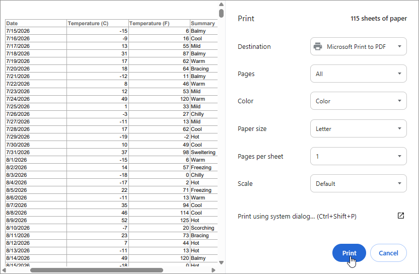

# Blazor Grid – Print Data

This example uses the browser's built-in dialog to print data displayed within the [DevExpress Blazor Grid](https://docs.devexpress.com/Blazor/403143/components/grid) component.

## Implementation Details

To print Blazor Grid data, you must:

1. Add a [DevExpress Blazor Grid](https://docs.devexpress.com/Blazor/403143/components/grid) to a page and bind it to data.
1. Add a [DevExpress Blazor Button](https://docs.devexpress.com/Blazor/405052/components/utility-controls/button) to the [Grid Toolbar](https://docs.devexpress.com/Blazor/DevExpress.Blazor.DxGrid.ToolbarTemplate#remarks).
1. In the button [Click](https://docs.devexpress.com/Blazor/DevExpress.Blazor.DxButtonBase.Click) event handler:
    - Disable the button to prevent repeated clicks while the request is being processed.
    - Call the [ExportToPdfAsync](https://docs.devexpress.com/Blazor/DevExpress.Blazor.DxGrid.ExportToPdfAsync(System.IO.Stream-DevExpress.Blazor.GridPdfExportOptions)) method to export Grid data to a PDF stream. The exported PDF reflects current Grid state (filters, sort order, and grouping) and is ready for printing.
    - Wrap the PDF stream in a [DotNetStreamReference](https://learn.microsoft.com/en-us/dotnet/api/microsoft.jsinterop.dotnetstreamreference) and pass it to JavaScript.
    - Re-enable the button.
1. In JavaScript:
    - Convert the stream to a PDF [Blob](https://developer.mozilla.org/en-US/docs/Web/API/Blob), create an object URL, and load it into a hidden [iframe](https://www.w3schools.com/tags/tag_iframe.asp).
    - Invoke the browser print dialog for the hidden [iframe](https://www.w3schools.com/tags/tag_iframe.asp).
    - Once the print dialog closes, remove the [iframe](https://www.w3schools.com/tags/tag_iframe.asp) and revoke the object URL.
1. _Optional._ Display the [DevExpress Blazor Wait Indicator](https://docs.devexpress.com/Blazor/405056/components/utility-controls/wait-indicator) within the **Print** toolbar button while processing the print request.

## Files to Review

- [Index.razor](./CS/GridPrint/Components/Pages/Index.razor)
- [print.js](./CS/GridPrint/wwwroot/js/print.js)

## Documentation

- [Export Blazor Grid Data to PDF](https://docs.devexpress.com/Blazor/405473/components/grid/export/pdf-export)

## More Examples

- [Blazor Grid - Export Detail Views](https://github.com/DevExpress-Examples/blazor-grid-master-detail-export)
